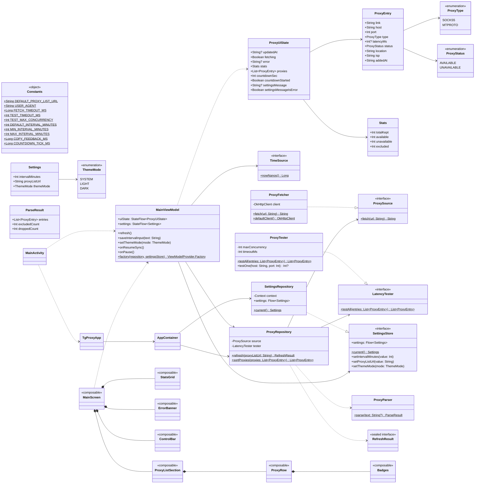
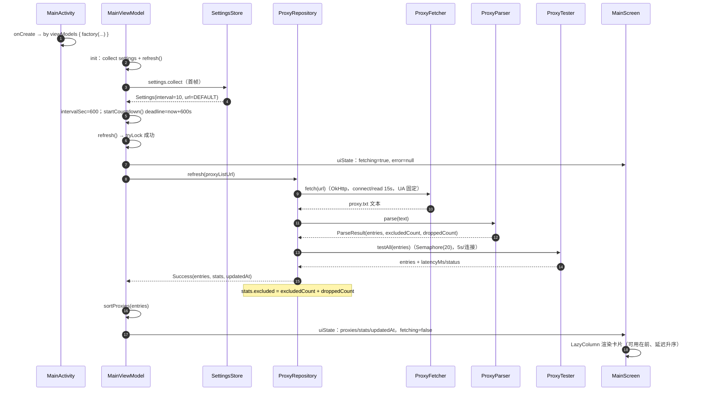
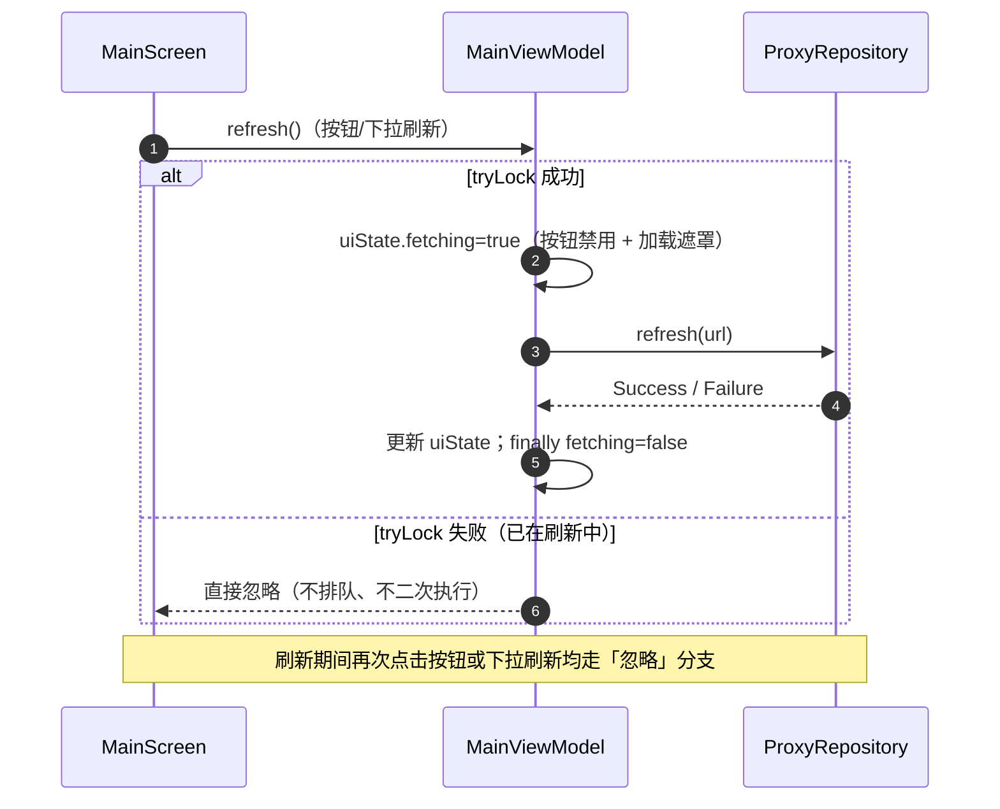
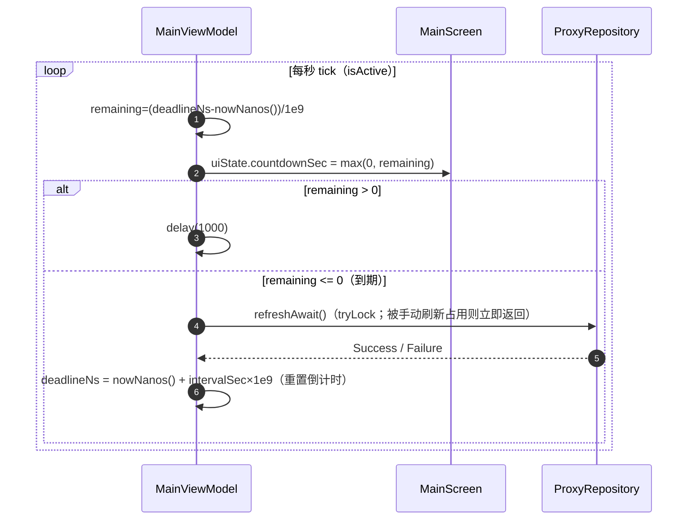
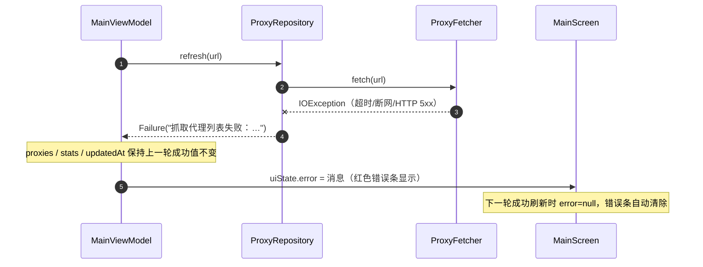
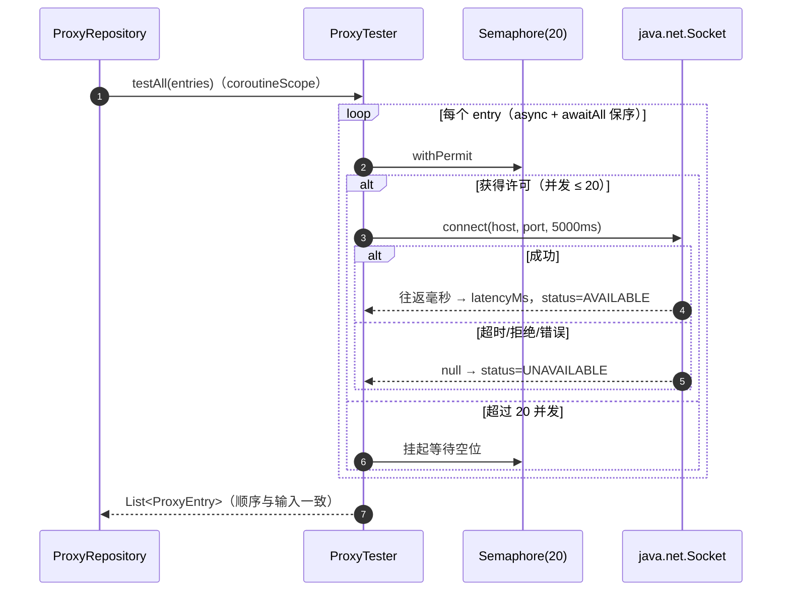
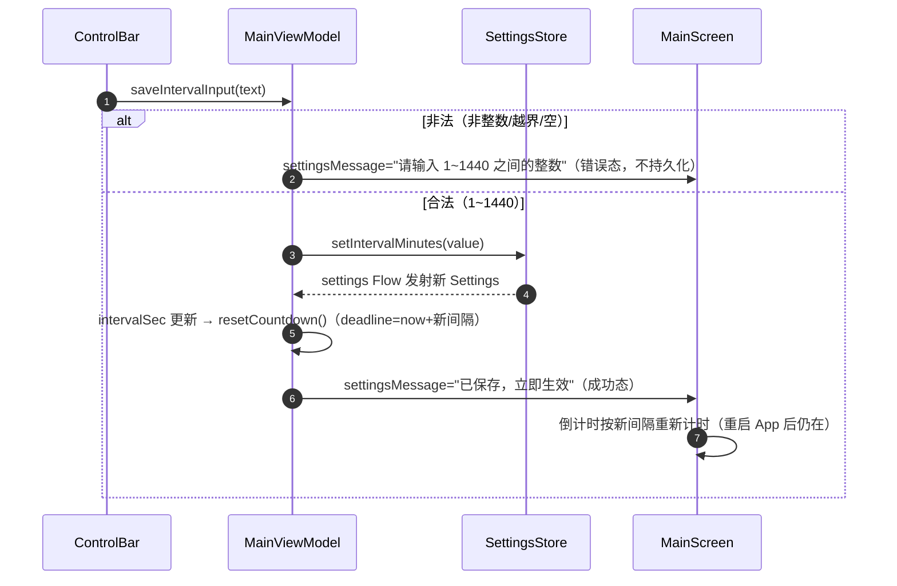
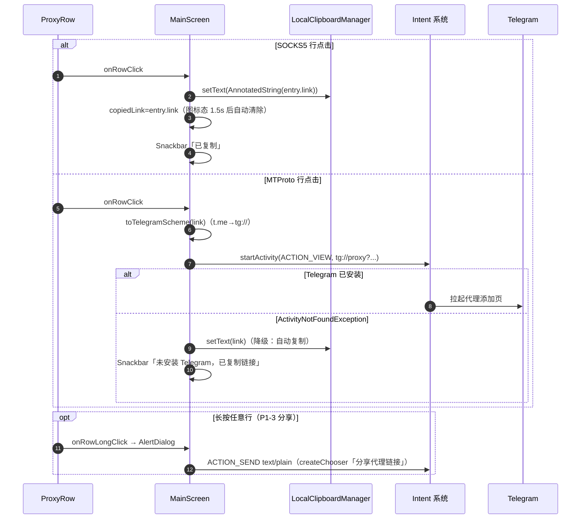
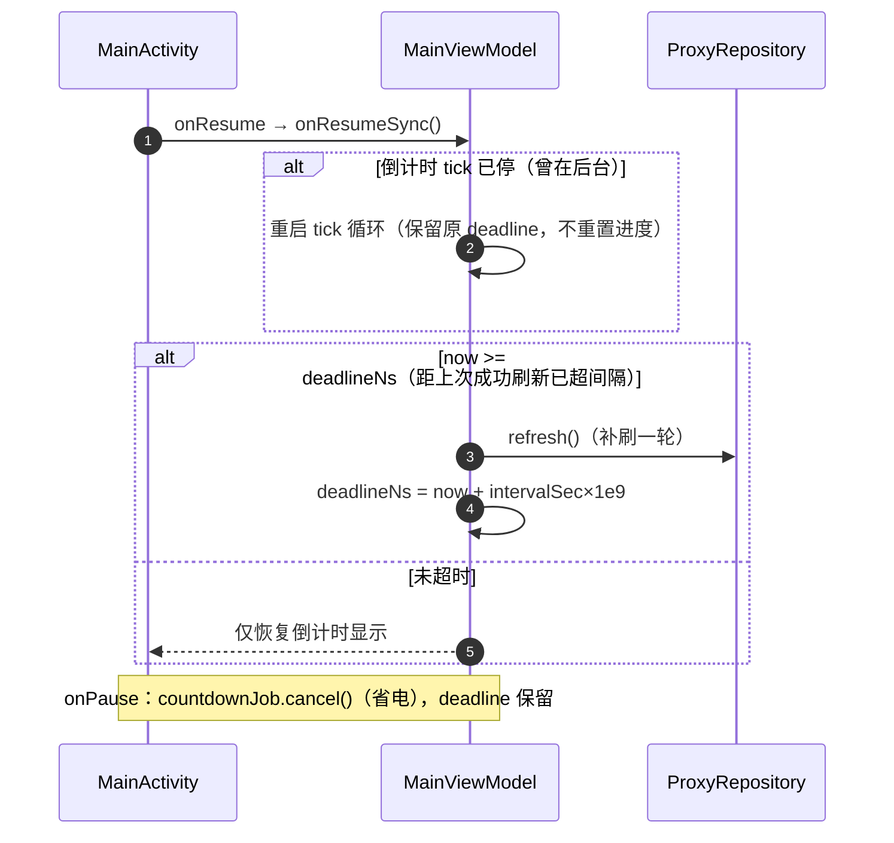
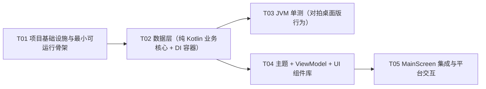

# tgproxy 安卓版 系统架构设计与任务分解

> 角色：架构师 高见远 | 日期：2026-10-22 | 消费方：工程师（严格按 §7 任务列表施工）、测试（按 §8 + PRD §7 验收）
> 上游输入：`docs/PRD.md`（产品经理 许清楚，v1.0 增量）；桌面版基线 `2026-10-21-23-09-27/tgproxy/`（proxy_manager.py / app.py / static/index.html，245 项测试通过）

---

> ## ⚠️ v2.0.0 变更记录（2026-10-26，高于本文以下所有条款）
>
> v2.0.0 起安卓版与桌面版测试口径对齐，本文其余章节为 v1.x 设计快照，以下列变更为准：
>
> 1. **测试管线**：TCP 预筛（`ProxyTester`，`Semaphore(128)`，5s 超时，逐条进度上报）→ **TG 实测双闸**（新类 `data/TelegramGate.kt`：SOCKS5 无认证握手 → CONNECT Telegram DC 149.154.167.51:443，再 CONNECT desktop.telegram.org + TLS + HTTP 状态行；两关串行共享单节点 20s 总预算、单关 8s；并发 96，`TelegramGateCaller` 注入点）→ **1000ms 门槛**（`Constants.TG_LATENCY_LIMIT_MS`，超门槛计入 tg_failed）。
> 2. **统计**：`Stats` 由四项改五项（available / unverified / tgFailed / dropped / excluded / tested），口径契约 available+unverified+tgFailed+dropped=tested；UI 由 `StatsGrid` 改为 `StatChips`（横滑胶囊）。
> 3. **进度**：新增 `model/RefreshProgress`（FETCH / TCP_TEST / TG_TEST 三阶段 done/total），`ProxyRepository.refresh(urls, onProgress)` 逐阶段上报，UI 新增 `ProgressCard`。
> 4. **known_good**：新增 `data/KnownGoodStore.kt`（应用私有目录 known_good.json；`enabled=false` 时不读不写；延迟/状态不落盘）；`Settings.knownGoodEnabled`（DataStore 键 `known_good_enabled`，默认开）；启动时先行展示沉淀列表，本轮刷新完成后替换。
> 5. **排序/延迟口径**：`latencyMs` 语义改为「经代理到 TG 数据中心往返」（TG 实测通过后回填）；`PROXY_COMPARATOR` 首键由 status 改为 `TgVerdict`；延迟着色（`Badges.latencyColor`）改为 <1000 绿 / <3000 橙 / 其余红 / null 灰（桌面版口径）。
> 6. **列表/交互**：列表仅含 TG 实测通过且 ≤1000ms 的节点；整卡点击唤起 Telegram 深链；行内复制/分享按钮（material-icons-extended）；known_good 先行展示条目半透明 + 「未测」胶囊。
> 7. **主题**：深色主题改为 Telegram 品牌配色（#17212B / #232E3C / #2AABEE）；浅色主题不变。
> 8. **可测性**：`ProxyTester`/`ProxyRepository` 增加可注入 `ioDispatcher`（JVM 单测全部协程共用同一测试调度器，消除跨线程派发竞态）；新增测试类 `TelegramGateTest` / `KnownGoodStoreTest`；`MainViewModelTest` / `ProxyRepositoryTest` / `ProxySortTest` / `ProxyTesterTest` 按新口径更新。测试矩阵：10 类 74 例 × debug/release = 148 例。
> 9. **版本**：versionCode 10 / versionName 2.0.0。
>
> 以下 v1.x 快照中与此冲突的条款（C6 的 20 并发、F13 的延迟三档、Stats 四项、`StatsGrid`、`TEST_MAX_CONCURRENCY=20` 等）均已废止。

> ## ⚠️ v2.1.0 变更记录（2026-10-26，叠加于 v2.0.0 之上）
>
> 1. **布局重构（列表优先）**：首屏 = 节点列表（LazyColumn + 下拉刷新）；状态条（进度/上轮摘要+耗时+倒计时）、错误条、空态卡作为列表首项；顶栏精简为 标题 + 更新时间/倒计时 + 设置齿轮；刷新按钮改右下角 FAB；设置（间隔/known_good/外观/数据源说明）收进 ModalBottomSheet。移除组件 `ControlBar` / `ProgressCard` / `StatChips`，新增 `StatusStrip` / `SettingsSheet` / `EmptyStateCard`，`ProxyList` 改为 `ProxyRowCard`（左 4dp 延迟色条 + 「使用」主按钮 64×48dp + 复制 40dp + 长按菜单）。
> 2. **统计口径拆分**：`Stats` 五项→六项，新增 `overThreshold`（TG 两关通过但 >1000ms）；契约 available+unverified+tgFailed+overThreshold+dropped=tested；桌面版 tg_failed = tgFailed+overThreshold（含超慢口径不变）。
> 3. **空态透明化**：0 节点时展示本轮全链路统计（测试/TCP 通过/TG 两关通过/超门槛）与原因说明（宁缺毋滥，超门槛不展示）。
> 4. **耗时摘要**：`ProxyUiState.lastDurationMs`（MainViewModel 以 timeSource 计时），空闲状态条显示「上轮测试 N，保留 X，耗时 Y」。
> 5. **应用图标**：自适应图标重画（#17212B 底 + #2AABEE 纸飞机 + 白速度线；API 24-25 矢量回退同步）。
> 6. **版本**：versionCode 11 / versionName 2.1.0；测试仍 10 类 74 例 × 双变体 = 148 全绿。

> ## ⚠️ v2.1.0 二次变更（2026-10-27，参考图风格化 + 连败拉黑，叠加于上方 v2.1.0 之上）
>
> 1. **仪表盘视觉（参考用户提供的两张参考图：蓝青渐变大卡 + 深色数据仪表盘）**：深色主题色板整体换为深藏青系（background #0D1526 / surface #141F36 / surfaceVariant #1C2A47 / outline #27365C / 次要文本 #8A94A6），强调色改青色 #00E5D0（primary）；新增 `HeroStatusCard`（蓝→青渐变大卡：空闲 = 「可用节点」44sp 大数字 + 最优延迟/上轮耗时 + 下次更新倒计时；刷新中 = 阶段名 + done/total + 白色进度条）与 `StatsCard`（五段统计：TG 未过/超门槛/TCP 不通/已拉黑/已排除）；`StatusStrip` 废止删除（formatCountdown/formatDuration 迁入 `HeroStatusCard.kt`）；`ProxyRowCard` 的「使用」按钮改 TG 蓝→青渐变填充、复制改圆底（surfaceVariant 圆形 40dp）、卡片去描边大圆角 16dp；标题改中文「TG 代理」。
> 2. **连败拉黑（对齐桌面 v1.9.0）**：新增纯 Kotlin `KnownBadStore`（应用私有目录 known_bad.json；`KNOWN_BAD_STREAK_LIMIT=3` / `KNOWN_BAD_EXPIRY_MS=48h` / `KNOWN_BAD_MAX_ENTRIES=10000`，时钟注入可测；记录只在内存累加、轮末统一 persist）。管线接入：抽样后过滤 `isBlacklisted` 节点（不进 TCP 预筛）→ TCP 不通或 TG FAIL 连败 +1 → TG PASS（含超门槛）清零 → 轮末落盘。`Stats` 新增 `blacklisted`（独立于 tested 口径）；设置弹层数据源说明补充拉黑规则；空态卡补充「连续失败拉黑跳过 N 个」行。
> 3. **测试**：新增 `KnownBadStoreTest`（7 例）+ `ProxyRepositoryTest` 连败四场景（4 例）；11 类 85 例 × 双变体 = 170 全绿。

---

## 1. 实现方案与框架选型

### 1.1 核心技术挑战与对策

| # | 挑战 | 对策 |
|---|---|---|
| C1 | **核心行为 1:1 保真**：解析/筛选/去重/测试/排序/统计规则必须与桌面版 `proxy_manager.py` 逐字等价 | 解析器、测试器、仓储、模型全部设计为**纯 Kotlin（零 Android import）**，规则以纯函数落地；JVM 单测对拍（§7 T03） |
| C2 | **桌面版 HTTP 服务消亡**：`app.py` 的 TgProxyServer/ApiHandler/端口探测整体移除，UI 与状态不能靠轮询 | 单 Activity + Compose + ViewModel + StateFlow 响应式直推；`ON_RESUME` 同步替代 `visibilitychange` + 2.5s 轮询 |
| C3 | **前台定时刷新**：桌面版后台调度线程常驻，安卓仅前台 | ViewModel 内协程倒计时循环（每秒 tick，注入 `TimeSource` 便于虚拟时间单测）；`onPause` 停 tick 省电、`onResume` 超龄补刷；WorkManager 列为 P2 但 `ProxyRepository` 无 Android 依赖，可直接被 Worker 复用（扩展位已留） |
| C4 | **刷新互斥**：桌面版 `ProxyManager._fetching` 保证不并发第二轮 | ViewModel 内 `Mutex.tryLock()` 语义完全等价（第二调用直接忽略，不排队） |
| C5 | **抓取失败降级**：失败要保留旧列表 + 错误条 | `ProxyRepository.refresh()` 返回 `RefreshResult.Failure`，ViewModel 只更新 `error` 字段，`proxies/stats/updatedAt` 原样保留 |
| C6 | **20 并发 TCP 测试**：桌面版 ThreadPoolExecutor(max_workers=20) | `ProxyTester` 用 `kotlinx.coroutines.sync.Semaphore(20)` + `Dispatchers.IO`，`java.net.Socket` 直连，5s 超时 |
| C7 | **行为保真 + 可测性冲突**：OkHttp/DataStore 是 Android 生态库，直接依赖会让仓储无法 JVM 单测 | 面向接口编程：`ProxySource`（抓取）、`LatencyTester`（测试）、`SettingsStore`（设置）、`TimeSource`（时钟）均为函数式接口，生产实现注入、测试注入假件 |
| C8 | **minSdk 24 的 API 限制** | 不使用 `java.time`（API 26+）——`updatedAt` 用 `SimpleDateFormat` 本地时区格式化（与桌面 `strftime` 等价），无需 core library desugaring；不使用 `resolveActivity` 判断 Telegram（targetSdk 30+ 包可见性过滤会误判），改用 try/catch `ActivityNotFoundException` |

### 1.2 框架与版本组合（真实存在且相互兼容，选取 2024Q4 稳定组合）

| 组件 | 版本 | 选型理由 |
|---|---|---|
| Gradle | **8.9**（wrapper 分发包 `gradle-8.9-bin.zip`） | AGP 8.7 的最低要求版本即 8.9；支持 JDK 17/21 |
| Android Gradle Plugin | **8.7.3** | 稳定支持 compileSdk/targetSdk 35；与 Kotlin 2.0.21 是社区广泛验证的组合 |
| Kotlin | **2.0.21** | Compose 编译器随 Kotlin 2.x 内置（插件 `org.jetbrains.kotlin.plugin.compose`），无需再对齐 `composeCompiler` 独立版本 |
| JDK | **17**（Gradle 运行与编译均需） | AGP 8.x 硬性要求 JDK 17；Android Studio（JBR 17）开箱即用 |
| compileSdk / targetSdk / minSdk | **35 / 35 / 24** | PRD 5.3 规定 |
| Compose BOM | **2024.10.01**（→ compose-ui 1.7.5 / material3 1.3.1） | material3 1.3.1 提供 `PullToRefreshBox`（P1-2 下拉刷新，`@ExperimentalMaterial3Api`） |
| androidx.activity | **activity-compose 1.9.3** | `ComponentActivity` + `setContent` |
| androidx.lifecycle | **2.8.7**（lifecycle-runtime-compose / lifecycle-viewmodel-compose） | `collectAsStateWithLifecycle()`、`viewModels()` |
| androidx.navigation | **navigation-compose 2.8.3** | PRD 5.3 要求预留 Navigation Compose（本期单目的地） |
| com.squareup.okhttp3 | **okhttp 4.12.0** | 同步 `execute()` 包 `withContext(Dispatchers.IO)`，等价桌面版 `urllib.urlopen`；UA 与 15s 超时可精确复刻 |
| androidx.datastore | **datastore-preferences 1.1.1** | PRD 规定的配置持久化（键 `interval_minutes` / `proxy_list_url`，新增 `theme_mode` 见 §5） |
| org.jetbrains.kotlinx | **kotlinx-coroutines 1.9.0**（含 coroutines-test） | 倒计时循环、并发测试、`StateFlow`、JVM 单测 `runTest` |
| junit | **4.13.2** | JVM 单测对拍桌面版 |

**明确不引入**：`com.google.android.material`（XML Material 组件库）——PRD 5.3 禁止 XML/View 体系混用，主题父级直接用平台 `android:Theme.Material.Light.NoActionBar`；`material-icons-extended`——只用 core 图标集（Refresh/Share/MoreVert/Warning/Check 均在 core 中）；Gradle Version Catalog（`gradle/libs.versions.toml`）管理全部依赖（PRD 5.3 要求）。

### 1.3 架构模式

**单 Activity + Jetpack Compose + MVVM + 响应式单向数据流（无本地服务器、无轮询）**：

```
┌─────────────────────────────────────────────────────────────┐
│ UI 层（androidx）  MainActivity / MainScreen / components / theme │
│   collectAsStateWithLifecycle() ← uiState: StateFlow<ProxyUiState>│
│   用户事件（刷新/保存/点击条目/下拉/主题）→ viewModel.xxx()          │
├─────────────────────────────────────────────────────────────┤
│ ViewModel 层  MainViewModel：UiState + 倒计时协程 + 刷新互斥(Mutex) │
│   + 间隔保存（DataStore）+ ON_RESUME 补刷                          │
├─────────────────────────────────────────────────────────────┤
│ Data/Domain 层（纯 Kotlin，JVM 可单测）                            │
│   ProxyParser（解析/筛选/去重/计数）                              │
│   ProxyTester（Socket + Semaphore(20)，5s）                      │
│   ProxyRepository（编排 fetch→parse→test→stats→sort）             │
│   model/*（ProxyEntry/Stats/Settings/ProxyUiState + normalize 纯函数）│
├─────────────────────────────────────────────────────────────┤
│ Platform 层（Android）  ProxyFetcher(OkHttp) / SettingsRepository   │
│   (DataStore) / AppContainer(手工 DI) / MainActivity               │
└─────────────────────────────────────────────────────────────┘
```

- 线程模型：所有 IO（抓取/TCP 测试/DataStore）在 `Dispatchers.IO`；解析与排序为纯 CPU 操作且随抓取协程上下文执行（单源文本 <1 万行，耗时毫秒级）；UI 状态经 `StateFlow` 主线程推送。
- 刷新管线（与桌面版 `_run_refresh` 完全同序）：`fetch → parse → testAll(并发) → stats → sort → 更新 State`。
- 与桌面版的**消亡映射**（PRD 6.2）：本地 HTTP 服务/端口探测/REST API/静态页全部移除；`RefreshScheduler` → ViewModel 倒计时协程；`ProxyManager.get_state()` 快照 → `StateFlow<ProxyUiState>`；线程锁 → `Mutex` + 单线程化协程。

### 1.4 核心行为保真清单（工程师与测试共同核对）

| # | 桌面版行为 | 安卓实现位置 | 单测覆盖（T03） |
|---|---|---|---|
| F1 | 抓取超时 15s | `Constants.FETCH_TIMEOUT_MS` → OkHttp connect/read timeout | —（集成验证） |
| F2 | UA `tgproxy/1.0 (local Telegram proxy manager)` | `ProxyFetcher` header | — |
| F3 | IPv4 严格校验（4 段纯数字 0-255，含 X 掩码丢弃） | `ProxyParser.parseIpv4` | ProxyParserTest 用例 8/9 |
| F4 | 端口 1~65535 | `ProxyParser.parsePort` | ProxyParserTest 用例 9 |
| F5 | host:port 去重（socks5 与 MTProto 共用 seen 集合） | `ProxyParser.parse` | ProxyParserTest 用例 10 |
| F6 | 仅保留 socks5/MTProto（tg://proxy、t.me/www.t.me/proxy 路径前缀 proxy） | `ProxyParser.isMtprotoUrl` + scheme 分支 | ProxyParserTest 用例 2/3/15 |
| F7 | http/https/ss/vmess 等计入「已排除」（合法地址去重计数） | `ProxyParser` excludedSeen | ProxyParserTest 用例 6 |
| F8 | 非法行（掩码 X / 无端口 / 缺 secret / 无 scheme://）计 dropped | `ProxyParser` | 用例 4/5/7/8/11/12 |
| F9 | **excluded 统计 = excluded + dropped 合并** | `ProxyRepository.refresh` 统计 | ProxyRepositoryTest 用例 1 |
| F10 | MTProto secret 缺失/非法 server/port → 丢弃 | `ProxyParser.parseMtproto` | 用例 4/5 |
| F11 | 元数据提取（入库时间正则、[标签] 剔除、地区/ISP 按 `—` 多形态分隔） | `ProxyParser.parseMeta` | 用例 1/13/14 |
| F12 | 排序：可用在前、延迟升序、不可用在后、host/port 兜底 | `ProxyRepository.PROXY_COMPARATOR` | ProxySortTest 全部 |
| F13 | 延迟三档着色 <200 绿 / <600 橙 / ≥600 或失败 红/灰 | `Badges.latencyColor` | —（UI 验收） |
| F14 | 测试：TCP connect 5s 超时、20 并发、失败 latency=null | `ProxyTester` | ProxyTesterTest 全部 |
| F15 | 抓取失败：保留旧列表 + 错误「抓取代理列表失败：…」 | `RefreshResult.Failure` + VM 只改 error | MainViewModelTest 用例 3 |
| F16 | 间隔：默认 10、范围 1~1440、保存即重置倒计时、持久化、损坏回退默认 | `Settings` normalize + `SettingsStore` + VM | SettingsNormalizeTest + MainViewModelTest 用例 4 |
| F17 | 启动即刷新；回前台同步、超龄补刷 | VM `init` + `onResumeSync` | MainViewModelTest 用例 1/6 |
| F18 | 刷新互斥（`_fetching` 语义） | `Mutex.tryLock()` | MainViewModelTest 用例 2 |
| F19 | 复制反馈 1.5s；倒计时格式「X 分 X 秒 / X 秒」 | `Constants.COPY_FEEDBACK_MS`、`formatCountdown` | —（UI 验收） |

---

## 2. 项目文件列表（完整相对路径树，从 `tgproxy-android/` 根起）

```
tgproxy-android/
├── .gitignore                                  # 忽略 local.properties/.gradle/build/.idea 等
├── README.md                                   # 构建运行说明（T01）
├── settings.gradle.kts                         # 仓库源 + rootProject.name=tgproxy_android + include(":app")
├── build.gradle.kts                            # 根构建：三个插件 apply false
├── gradle.properties                           # JVM 参数 / AndroidX / 非传递 R 类
├── gradle/
│   ├── libs.versions.toml                      # Version Catalog：全部依赖与插件版本
│   └── wrapper/
│       └── gradle-wrapper.properties           # distributionUrl=gradle-8.9-bin.zip
├── gradlew / gradlew.bat                       # 标准脚本（gradle wrapper --gradle-version 8.9 生成）
└── app/
    ├── build.gradle.kts                        # AGP 配置 + 全部依赖（§6）
    ├── proguard-rules.pro                      # 仅注释占位（okhttp 自带 consumer 规则，minify 关闭）
    └── src/
        ├── main/
        │   ├── AndroidManifest.xml             # 仅 INTERNET 权限；单 Activity；Application=.TgProxyApp
        │   ├── java/com/tgproxy/
        │   │   ├── Constants.kt                # 全部常量集中地（超时/并发/阈值/默认值/反馈时长）
        │   │   ├── TgProxyApp.kt               # Application：初始化 AppContainer
        │   │   ├── MainActivity.kt             # 单 Activity：viewModels + setContent + onResume/onPause 转发
        │   │   ├── AppContainer.kt             # 手工 DI：OkHttpClient/ProxyFetcher/ProxyRepository/SettingsStore
        │   │   ├── model/
        │   │   │   ├── Proxy.kt                # ProxyType/ProxyStatus 枚举 + ProxyEntry + Stats
        │   │   │   ├── Settings.kt             # ThemeMode + Settings + normalize*/parseIntervalInput 纯函数
        │   │   │   └── ProxyUiState.kt         # UI 状态快照（PRD 5.4）
        │   │   ├── data/
        │   │   │   ├── ProxyFetcher.kt         # fun interface ProxySource + OkHttp 实现（15s 超时/UA）
        │   │   │   ├── ProxyParser.kt          # 桌面版 parse_proxy_text 等价移植（纯 Kotlin）
        │   │   │   ├── ProxyTester.kt          # fun interface LatencyTester + Socket/Semaphore(20) 实现
        │   │   │   ├── ProxyRepository.kt      # 编排刷新管线 + 排序比较器 + RefreshResult
        │   │   │   └── SettingsRepository.kt   # fun interface SettingsStore + DataStore 实现
        │   │   └── ui/
        │   │       ├── MainViewModel.kt        # StateFlow + 倒计时 + 互斥 + 设置动作 + TimeSource + factory
        │   │       ├── MainScreen.kt           # Scaffold 单屏：头部/统计/错误条/控制区/列表/页脚 + 交互编排
        │   │       ├── ProxyLinks.kt           # toTelegramScheme 纯函数 + Intent 构建（VIEW/SEND）
        │   │       ├── components/
        │   │       │   ├── Badges.kt           # StatusBadge/TypeBadge/LatencyText/latencyColor（三档着色）
        │   │       │   ├── StatsGrid.kt        # 统计卡区（2×2 / 宽屏 4 列自适应）
        │   │       │   ├── ErrorBanner.kt      # 红色错误提示条（条件显示）
        │   │       │   ├── ControlBar.kt       # 刷新按钮 + 间隔输入/保存 + 提示 + 倒计时
        │   │       │   └── ProxyList.kt        # PullToRefreshBox + LazyColumn + 空态/loading 遮罩 + 长按菜单
        │   │       └── theme/
        │   │           ├── Color.kt            # 桌面版色板 1:1（主色/状态/背景/徽章/延迟）
        │   │           ├── Type.kt             # Typography（默认 + 等宽链接样式）
        │   │           └── Theme.kt            # light/dark ColorScheme + TgProxyTheme(themeMode)
        │   └── res/
        │       ├── drawable/
        │       │   └── ic_launcher_foreground.xml      # 矢量前景（白色双向箭头）
        │       ├── mipmap-anydpi-v26/
        │       │   └── ic_launcher.xml                  # adaptive-icon（26+）
        │       ├── mipmap-mdpi/ic_launcher.xml          # API 24-25 矢量回退（蓝底白箭头）
        │       ├── mipmap-hdpi/ic_launcher.xml
        │       ├── mipmap-xhdpi/ic_launcher.xml
        │       ├── mipmap-xxhdpi/ic_launcher.xml
        │       └── mipmap-xxxhdpi/ic_launcher.xml
        │       └── values/
        │           ├── strings.xml             # app_name=Telegram 代理
        │           ├── colors.xml              # page_background / ic_launcher_background
        │           └── themes.xml              # Theme.TgProxy（平台 Material.NoActionBar 父级）
        │       └── values-night/
        │           └── themes.xml              # 深色窗口背景（防冷启动闪白）
        └── test/
            └── java/com/tgproxy/
                ├── ProxyParserTest.kt          # 解析/筛选/去重/计数/元数据 对拍桌面版
                ├── ProxySortTest.kt            # 排序三键 + null 延迟 + 兜底
                ├── ProxyRepositoryTest.kt      # 假 Source/假 Tester：stats/excluded 合并/失败降级
                ├── ProxyTesterTest.kt          # 真实 Socket：可用/拒绝/顺序保持
                ├── SettingsNormalizeTest.kt    # 间隔校正/URL 回退/输入解析
                ├── ProxyLinksTest.kt           # toTelegramScheme 纯函数
                └── MainViewModelTest.kt        # 启动刷新/互斥/失败保留/间隔重置/到期刷新/补刷（虚拟时间）
```

> 说明：① `gradlew`/`gradlew.bat` 为标准 Gradle 脚本（由 `gradle wrapper --gradle-version 8.9` 生成或从任意 AS 工程拷贝，内容无需定制）；② `local.properties`（SDK 路径）**不入库**（.gitignore）；③ 图标采用矢量 + anydpi-v26 自适应（避免二进制 PNG 入库，保证"AS 打开即可构建"）；④ 本期不建 `androidTest` 源集（验收以 JVM 单测 + 手动/PRD §7 清单为主），构建脚本中保留 androidTest 依赖声明供后续扩展。

---

## 3. 数据模型与接口

### 3.1 类图（另存 `docs/class-diagram.mermaid`）



### 3.2 关键数据模型（`com.tgproxy.model`，纯 Kotlin）

```kotlin
// model/Proxy.kt
enum class ProxyType { SOCKS5, MTPROTO }
enum class ProxyStatus { AVAILABLE, UNAVAILABLE }

data class ProxyEntry(
    val link: String,                 // "socks5://host:port" 或 MTProto 完整链接（桌面版原样重建）
    val host: String,                 // 严格校验后的 IPv4
    val port: Int,
    val type: ProxyType,
    val latencyMs: Int? = null,       // 失败为 null
    val status: ProxyStatus = ProxyStatus.UNAVAILABLE,
    val location: String = "",        // 地区
    val isp: String = "",             // ISP
    val addedAt: String = "",         // 入库时间（如 "10-21 22:58"）
)

data class Stats(
    val totalKept: Int = 0,
    val available: Int = 0,
    val unavailable: Int = 0,
    val excluded: Int = 0,            // = excludedCount + droppedCount（与桌面版一致）
)

// model/Settings.kt
enum class ThemeMode { SYSTEM, LIGHT, DARK }
data class Settings(
    val intervalMinutes: Int = Constants.DEFAULT_INTERVAL_MINUTES,   // 10
    val proxyListUrl: String = Constants.DEFAULT_PROXY_LIST_URL,
    val themeMode: ThemeMode = ThemeMode.SYSTEM,
)
// 纯函数（JVM 可测，等价桌面版 normalize_config 的安卓子集）：
fun normalizeIntervalMinutes(raw: Int?): Int      // null→10；越界夹紧至 1..1440
fun normalizeProxyListUrl(raw: String?): String   // null/空/非 http(s):// 开头 → 默认源
fun normalizeThemeMode(raw: String?): ThemeMode   // 未知值 → SYSTEM
fun parseIntervalInput(text: String): Int?        // 仅接受 1~1440 纯整数（比桌面 parseInt 严格，PRD P0-7）

// model/ProxyUiState.kt
data class ProxyUiState(
    val updatedAt: String? = null,          // "yyyy-MM-dd HH:mm:ss"
    val fetching: Boolean = false,
    val error: String? = null,              // 抓取失败等
    val stats: Stats = Stats(),
    val proxies: List<ProxyEntry> = emptyList(),   // 已排序
    val countdownSec: Int = 0,
    val countdownStarted: Boolean = false,  // false 时 UI 显示「--」
    val settingsMessage: String? = null,    // 间隔保存结果提示
    val settingsMessageIsError: Boolean = false,
)
```

### 3.3 数据层接口签名（`com.tgproxy.data`，除 SettingsRepository 外零 Android 依赖）

```kotlin
// data/ProxyFetcher.kt
fun interface ProxySource { suspend fun fetch(url: String): String }
class ProxyFetcher(private val client: OkHttpClient = defaultClient()) : ProxySource {
    override suspend fun fetch(url: String): String     // withContext(IO)；非 2xx 抛 IOException("HTTP {code}")
    companion object { fun defaultClient(): OkHttpClient }  // connect/read timeout 均 15s，UA 固定
}

// data/ProxyParser.kt  —— parse_proxy_text 逐字等价移植
class ProxyParser {
    data class ParseResult(val entries: List<ProxyEntry>, val excludedCount: Int, val droppedCount: Int)
    fun parse(text: String?): ParseResult
    // internal：parseIpv4/parsePort/parseMeta/isMtprotoUrl/parseMtproto（单测可直接覆盖边界）
}

// data/ProxyTester.kt
fun interface LatencyTester { suspend fun testAll(entries: List<ProxyEntry>): List<ProxyEntry> }
class ProxyTester(
    private val maxConcurrency: Int = Constants.TEST_MAX_CONCURRENCY,   // 20
    private val timeoutMs: Int = Constants.TEST_TIMEOUT_MS,             // 5000
) : LatencyTester {
    override suspend fun testAll(entries: List<ProxyEntry>): List<ProxyEntry>  // Semaphore+async，保序
    fun testOne(host: String, port: Int): Int?    // Socket.connect 5s；成功=往返毫秒，失败=null
}

// data/ProxyRepository.kt
class ProxyRepository(
    private val source: ProxySource,
    private val tester: LatencyTester = ProxyTester(),
) {
    sealed interface RefreshResult {
        data class Success(val entries: List<ProxyEntry>, val stats: Stats, val updatedAt: String) : RefreshResult
        data class Failure(val error: String) : RefreshResult   // error 前缀固定「抓取代理列表失败：」
    }
    suspend fun refresh(proxyListUrl: String): RefreshResult    // fetch→parse→test→stats；异常不抛出，转为 Failure
    fun sortProxies(proxies: List<ProxyEntry>): List<ProxyEntry>  // 可用在前(0/1)→延迟升序(null→+∞)→host→port
}

// data/SettingsRepository.kt
interface SettingsStore {
    val settings: Flow<Settings>                 // DataStore 变更即推；normalize 后暴露
    suspend fun current(): Settings              // 首帧读取（dataStore.data.first()）
    suspend fun setIntervalMinutes(value: Int)   // 写入前 normalize
    suspend fun setProxyListUrl(value: String)
    suspend fun setThemeMode(mode: ThemeMode)
}
class SettingsRepository(context: Context) : SettingsStore   // 键：interval_minutes / proxy_list_url / theme_mode
```

### 3.4 ViewModel 公开 API（`com.tgproxy.ui.MainViewModel`）

```kotlin
fun interface TimeSource { fun nowNanos(): Long }   // 默认 System.nanoTime()；测试注入假时钟（虚拟时间）

class MainViewModel(
    private val repository: ProxyRepository,
    private val settingsStore: SettingsStore,
    private val timeSource: TimeSource = TimeSource { System.nanoTime() },
) : ViewModel() {
    val uiState: StateFlow<ProxyUiState>            // UI 唯一状态源
    val settings: StateFlow<Settings>               // stateIn(Eagerly)，主题/URL/间隔消费

    fun refresh()                                   // 启动/手动/下拉/到期：fire-and-forget，互斥由 tryLock 保证
    fun saveIntervalInput(text: String)             // 校验 1~1440；非法→settingsMessage 错误且不持久化；合法→持久化+「已保存，立即生效」
    fun setThemeMode(mode: ThemeMode)               // 循环 SYSTEM→LIGHT→DARK
    fun onResumeSync()                              // 恢复 tick（保留 deadline）；超龄则立即补刷并重置 deadline
    fun onPause()                                   // 取消倒计时 tick（省电），deadline 保留
    companion object { fun factory(repository: ProxyRepository, settingsStore: SettingsStore): ViewModelProvider.Factory }
}
```

**ViewModel 行为契约（精确到可实现）**：
1. `init`：① `viewModelScope.launch { settingsStore.settings.collect { … } }`——首个发射设置 `intervalSec` 并 `startCountdown()`，后续发射且间隔变化时 `resetCountdown()`；② 立即 `refresh()`（启动即刷新，P0-10）。
2. `refreshAwait()`（私有挂起，被 `refresh()` 与倒计时共用）：`refreshMutex.tryLock()` 失败即返回（互斥）；成功则 `uiState.fetching=true, error=null` → `repository.refresh(settings.value.proxyListUrl)` → Success 时写入 `sortProxies(entries)/stats/updatedAt/error=null`；Failure 时**仅**写 `error`（旧列表保留）；finally `fetching=false` + 解锁。
3. 倒计时循环（`viewModelScope` 协程）：每秒计算 `remaining = (deadlineNs - now)/1e9`，写 `countdownSec`（≥0）与 `countdownStarted=true`；`remaining<=0` 时**挂起等待** `refreshAwait()` 完成后 `deadlineNs = now + intervalSec*1e9`（与桌面版阻塞式调度语义一致，避免长刷新期间每秒空转重试）。
4. `onResumeSync()`：tick 已停则重启循环但**不重置 deadline**（保进度）；若 `now >= deadlineNs`（超龄）→ `refresh()` 并 `deadlineNs = now + interval`。
5. `saveIntervalInput`：非法输入 → `settingsMessage="请输入 1~1440 之间的整数", settingsMessageIsError=true`，不写 DataStore；合法 → 写 DataStore，消息 `"已保存，立即生效"`；倒计时重置由 settings Flow 发射触发（单一事实来源）。

### 3.5 UI 组件签名（`com.tgproxy.ui.components`）

```kotlin
@Composable fun MainScreen(viewModel: MainViewModel, modifier: Modifier = Modifier)   // Scaffold 单屏
@Composable fun StatsGrid(stats: Stats, modifier: Modifier = Modifier)                // <600dp 2×2，≥600dp 4 列
@Composable fun ErrorBanner(message: String, modifier: Modifier = Modifier)           // errorContainer 红色条
@Composable fun ControlBar(
    fetching: Boolean, intervalText: String, onIntervalTextChange: (String) -> Unit,
    onRefresh: () -> Unit, onSaveInterval: () -> Unit,
    settingsMessage: String?, settingsMessageIsError: Boolean,
    countdownSec: Int, countdownStarted: Boolean, modifier: Modifier = Modifier,
)
@Composable fun ProxyListSection(
    proxies: List<ProxyEntry>, fetching: Boolean, copiedLink: String?,
    onRefresh: () -> Unit, onRowClick: (ProxyEntry) -> Unit, onRowLongClick: (ProxyEntry) -> Unit,
    modifier: Modifier = Modifier,
)   // PullToRefreshBox + LazyColumn(key = link, contentType) + 空态/加载遮罩 + 长按 AlertDialog
@Composable fun ProxyRow(entry: ProxyEntry, copied: Boolean, onClick: () -> Unit, onLongClick: () -> Unit, modifier: Modifier = Modifier)
@Composable fun StatusBadge(status: ProxyStatus, modifier: Modifier = Modifier)
@Composable fun TypeBadge(type: ProxyType, modifier: Modifier = Modifier)
@Composable fun LatencyText(latencyMs: Int?, modifier: Modifier = Modifier)           // <200 绿/<600 橙/≥600 红/null 灰
fun formatCountdown(totalSec: Int): String    // "X 分 X 秒" / "X 秒" / "--"

// ui/ProxyLinks.kt
fun toTelegramScheme(link: String): String                                   // 纯函数：https?://(www.)?t.me/proxy?q → tg://proxy?q
fun buildTelegramViewIntent(link: String): Intent                            // ACTION_VIEW + toTelegramScheme
fun buildShareIntent(link: String): Intent                                   // ACTION_SEND text/plain
```

---

## 4. 程序调用流程（另存 `docs/sequence-diagram.mermaid`）

### 4.1 启动即刷新（冷启动，P0-10）



### 4.2 手动刷新与互斥（P0-6，等价桌面版 `_fetching`）



### 4.3 前台定时刷新（P0-8/P0-12）



### 4.4 抓取失败降级（P0-1/P0-9，保留旧列表）



### 4.5 并发 TCP 测试（P0-3，Semaphore(20)）



### 4.6 保存间隔与倒计时重置（P0-7）



### 4.7 复制 / 分享 / MTProto 跳转（P0-5/P1-1/P1-3）



### 4.8 回前台同步与超龄补刷（PRD 5.2）



---

## 5. 待明确事项与假设

1. **SSL 免验证兜底不再移植**：桌面版 `fetch_proxy_text` 在首次失败后用 `ssl._create_unverified_context()` 重试一次，这是 Python 环境根证书缺失的兜底；安卓 OkHttp 走系统 CA Store，绕过证书验证属于安全倒退，**不实现**。可观测行为（失败 → 错误文案 + 保留旧列表）完全保留。
2. **Python `round()` 银行家舍入 vs Kotlin `roundToInt()` 四舍五入**：真实耗时命中 `.5` 毫秒边界概率可忽略，不做特殊处理（若对拍出现差异以测试为准修正）。
3. **`parse_qs` 解码细节**：MTProto 的 query 解析用 `URLDecoder` + 空值视为缺失近似实现（secret 只校验非空、不消费其值，解码差异不影响保留/丢弃判定）；`java.net.URI` 不在纯 Kotlin 层使用，个别 exotic 输入（非法 IPv6 括号等）与桌面版 `urlparse` 抛错的差异可忽略。
4. **新增 DataStore 键 `theme_mode`**（PRD 键表之外）：P1-4 要求"跟随系统 + 手动切换"，手动选择需重启后保持，故新增并持久化；normalize 未知值回退 SYSTEM。
5. **MTProto 跳转不做浏览器兜底**：PRD 5.2 提到 https 兜底，但 P1-1 验收口径为"未安装 Telegram → Snackbar 提示 + 降级复制"。采用 try `tg://` → `ActivityNotFoundException` → 复制 + Snackbar（不用 `resolveActivity`，规避 targetSdk 30+ 包可见性过滤误判）。如后续需要浏览器兜底，需在 manifest 声明 `<queries>` 并调整验收口径。
6. **数据源 URL 编辑本期不做**（P2，与桌面版 UI 一致）：`SettingsStore` 仍完整支持 `proxy_list_url` 键，页脚展示当前值。
7. **矢量启动图标**：为满足"AS 打开即可构建"且不引入二进制文件，图标用矢量 + `mipmap-anydpi-v26` 自适应；后续可替换位图。
8. **版本号无法联网验证**：选取 2024Q4 相互兼容的稳定组合（AGP 8.7.3 / Gradle 8.9 / Kotlin 2.0.21 / Compose BOM 2024.10.01 / OkHttp 4.12.0 / DataStore 1.1.1 / coroutines 1.9.0 / lifecycle 2.8.7 / activity-compose 1.9.3 / navigation-compose 2.8.3）。
9. **单语言**：本期仅简体中文，文案内联于 Composable（PRD 已给定文案），`strings.xml` 仅 `app_name`；多语言后续再抽取。

---

## 6. 依赖清单

### 6.1 Version Catalog（`gradle/libs.versions.toml`）

```toml
[versions]
agp = "8.7.3"
kotlin = "2.0.21"
coreKtx = "1.15.0"
activityCompose = "1.9.3"
lifecycle = "2.8.7"
composeBom = "2024.10.01"
navigationCompose = "2.8.3"
okhttp = "4.12.0"
datastore = "1.1.1"
coroutines = "1.9.0"
junit = "4.13.2"
androidxJunit = "1.2.1"
espresso = "3.6.1"

[libraries]
androidx-core-ktx = { group = "androidx.core", name = "core-ktx", version.ref = "coreKtx" }
androidx-activity-compose = { group = "androidx.activity", name = "activity-compose", version.ref = "activityCompose" }
androidx-lifecycle-runtime-compose = { group = "androidx.lifecycle", name = "lifecycle-runtime-compose", version.ref = "lifecycle" }
androidx-lifecycle-viewmodel-compose = { group = "androidx.lifecycle", name = "lifecycle-viewmodel-compose", version.ref = "lifecycle" }
androidx-compose-bom = { group = "androidx.compose", name = "compose-bom", version.ref = "composeBom" }
androidx-ui = { group = "androidx.compose.ui", name = "ui" }
androidx-ui-graphics = { group = "androidx.compose.ui", name = "ui-graphics" }
androidx-ui-tooling = { group = "androidx.compose.ui", name = "ui-tooling" }
androidx-ui-tooling-preview = { group = "androidx.compose.ui", name = "ui-tooling-preview" }
androidx-material3 = { group = "androidx.compose.material3", name = "material3" }
androidx-navigation-compose = { group = "androidx.navigation", name = "navigation-compose", version.ref = "navigationCompose" }
okhttp = { group = "com.squareup.okhttp3", name = "okhttp", version.ref = "okhttp" }
androidx-datastore-preferences = { group = "androidx.datastore", name = "datastore-preferences", version.ref = "datastore" }
kotlinx-coroutines-android = { group = "org.jetbrains.kotlinx", name = "kotlinx-coroutines-android", version.ref = "coroutines" }
kotlinx-coroutines-test = { group = "org.jetbrains.kotlinx", name = "kotlinx-coroutines-test", version.ref = "coroutines" }
junit = { group = "junit", name = "junit", version.ref = "junit" }
androidx-junit = { group = "androidx.test.ext", name = "junit", version.ref = "androidxJunit" }
androidx-espresso-core = { group = "androidx.test.espresso", name = "espresso-core", version.ref = "espresso" }
androidx-ui-test-junit4 = { group = "androidx.compose.ui", name = "ui-test-junit4" }
androidx-ui-test-manifest = { group = "androidx.compose.ui", name = "ui-test-manifest" }

[plugins]
android-application = { id = "com.android.application", version.ref = "agp" }
kotlin-android = { id = "org.jetbrains.kotlin.android", version.ref = "kotlin" }
kotlin-compose = { id = "org.jetbrains.kotlin.plugin.compose", version.ref = "kotlin" }
```

### 6.2 展开坐标（group:artifact:version，供核对）

**compile/runtime（app）**：
- `androidx.core:core-ktx:1.15.0`
- `androidx.activity:activity-compose:1.9.3`
- `androidx.lifecycle:lifecycle-runtime-compose:2.8.7`
- `androidx.lifecycle:lifecycle-viewmodel-compose:2.8.7`
- `androidx.compose:compose-bom:2024.10.01`（platform）
- `androidx.compose.ui:ui:1.7.5`（BOM 管治）
- `androidx.compose.ui:ui-graphics:1.7.5`（BOM 管治）
- `androidx.compose.ui:ui-tooling-preview:1.7.5`（BOM 管治）
- `androidx.compose.material3:material3:1.3.1`（BOM 管治）
- `androidx.navigation:navigation-compose:2.8.3`
- `com.squareup.okhttp3:okhttp:4.12.0`
- `androidx.datastore:datastore-preferences:1.1.1`
- `org.jetbrains.kotlinx:kotlinx-coroutines-android:1.9.0`

**test**：
- `junit:junit:4.13.2`
- `org.jetbrains.kotlinx:kotlinx-coroutines-test:1.9.0`

**androidTest（预留，本期无源集）**：`androidx.test.ext:junit:1.2.1`、`androidx.test.espresso:espresso-core:3.6.1`、`androidx.compose.ui:ui-test-junit4:1.7.5`（BOM 管治）

**debugImplementation**：`androidx.compose.ui:ui-tooling:1.7.5`、`androidx.compose.ui:ui-test-manifest:1.7.5`（BOM 管治）

**构建脚本插件**：`com.android.application:8.7.3`、`org.jetbrains.kotlin.android:2.0.21`、`org.jetbrains.kotlin.plugin.compose:2.0.21`

> 注：`androidx.compose.ui:ui:1.7.5` 等 1.7.x 版本由 BOM 2024.10.01 管治，依赖声明中**不写版本号**（仅 BOM 写版本）；上表展开坐标仅用于核对真实存在性。AGP 8.7.3 需 Gradle 8.9+ 与 JDK 17；`compileSdk=35` 对 AGP ≥8.6 无警告。

---

## 7. 任务列表（按实现顺序，工程师逐条执行）

### T01 项目基础设施与最小可运行骨架（P0）
- **依赖**：无
- **目标文件**：`settings.gradle.kts`、`build.gradle.kts`、`gradle.properties`、`gradle/libs.versions.toml`、`gradle/wrapper/gradle-wrapper.properties`、`gradlew`、`gradlew.bat`、`.gitignore`、`README.md`、`app/build.gradle.kts`、`app/proguard-rules.pro`、`app/src/main/AndroidManifest.xml`、`app/src/main/res/values/{strings,colors,themes}.xml`、`app/src/main/res/values-night/themes.xml`、`app/src/main/res/drawable/ic_launcher_foreground.xml`、`app/src/main/res/mipmap-anydpi-v26/ic_launcher.xml`、`app/src/main/res/mipmap-{mdpi,hdpi,xhdpi,xxhdpi,xxxhdpi}/ic_launcher.xml`、`app/src/main/java/com/tgproxy/TgProxyApp.kt`（占位空 Application）、`app/src/main/java/com/tgproxy/MainActivity.kt`（占位：`setContent { Text("tgproxy") }`，不依赖 VM）
- **完成判据**：JDK 17 下 `./gradlew :app:assembleDebug` 成功；可安装启动显示占位文案；manifest 仅 `INTERNET` 权限、单 Activity、`application android:name=".TgProxyApp"`；`local.properties` 不入库；`gradle-wrapper.properties` 指向 `gradle-8.9-bin.zip`。

### T02 数据层（纯 Kotlin 业务核心 + DI 容器）（P0）
- **依赖**：T01
- **目标文件**：`java/com/tgproxy/Constants.kt`、`model/Proxy.kt`、`model/Settings.kt`、`model/ProxyUiState.kt`、`data/ProxyFetcher.kt`（含 `ProxySource`）、`data/ProxyParser.kt`、`data/ProxyTester.kt`（含 `LatencyTester`）、`data/ProxyRepository.kt`、`data/SettingsRepository.kt`（含 `SettingsStore`）、`AppContainer.kt`、`TgProxyApp.kt`（修改：onCreate 初始化 `AppContainer`）
- **完成判据**：`ProxyParser/ProxyTester/ProxyRepository/ProxyFetcher/model/Constants/AppContainer` **无 androidx/android import**（`grep -r "android" app/src/main/java/com/tgproxy/{data,model}` 仅 `SettingsRepository.kt` 命中 `android.content.Context` 与 datastore）；`./gradlew :app:assembleDebug` 通过；`ProxyRepository/ProxyParser/ProxyTester` 可在 JVM 直接 `new` 并调用（不抛 `RuntimeException: Stub!`）。

### T03 JVM 单测（对拍桌面版行为）（P0）
- **依赖**：T02
- **目标文件**：`app/src/test/java/com/tgproxy/` 下 `ProxyParserTest.kt`、`ProxySortTest.kt`、`ProxyRepositoryTest.kt`、`ProxyTesterTest.kt`、`SettingsNormalizeTest.kt`、`ProxyLinksTest.kt`、`MainViewModelTest.kt`
- **测试用例设计（对拍点）**：
  - **ProxyParserTest**（PRD §7-1）：① socks5 完整行元数据提取（入库时间/[标签] 剔除/地区/ISP）；② `tg://proxy?server&port&secret` 保留且 link 原样重建；③ `https://t.me/proxy?...` 与 `https://www.t.me/proxy?...` 识别为 MTProto；④ 缺 secret / secret 为空 → dropped；⑤ server 非法 IPv4 或 port 越界 → dropped；⑥ http/https/ss/vmess/vless/trojan 合法地址计入 excluded 且按 host:port 去重；⑦ 非 Telegram 类型缺端口 → dropped；⑧ `X` 掩码 IPv4 → dropped；⑨ 端口 `0`/`99999`/非数字 → dropped；⑩ 重复 host:port（socks5 与 MTProto 之间也去重）只保留一条且不计任何计数；⑪ `#` 注释与空行跳过；⑫ 无 `scheme://` 行 → dropped；⑬ 分隔符多形态（`—`/`—`/` - `）切分地区/ISP；⑭ 无元数据行 → location/isp/addedAt 均为空串；⑮ `http://t.me/notproxy` → 按普通行处理 → dropped；⑯ 混合大样例断言 `(entries, excludedCount, droppedCount)` 三元组。
  - **ProxySortTest**（PRD §7-2）：可用在前；同可用按延迟升序；不可用整体在后；latency=null 排在同组末尾；host/port 兜底；输入列表不被修改。
  - **ProxyRepositoryTest**：① 成功 → stats 四项正确、`excluded == excludedCount + droppedCount`、`updatedAt` 匹配 `yyyy-MM-dd HH:mm:ss`、entries 保持解析序；② source 抛 `IOException` → `Failure` 且 `error` 以「抓取代理列表失败：」开头、不抛异常。
  - **ProxyTesterTest**：① `ServerSocket(0)` 监听端口 → available 且 `latencyMs != null`；② 已关闭端口（127.0.0.1:1）→ unavailable 且 null；③ 50 条目混合 → 顺序保持、数量守恒（Semaphore(20) 不死锁）。
  - **SettingsNormalizeTest**（PRD §7-5）：`normalizeIntervalMinutes(null/0/1441/-5/10)`、`normalizeProxyListUrl(null/""/"  "/"ftp://x"/"http://a")`、`parseIntervalInput(""/"abc"/"0"/"1441"/"10"/" 10 "/"10abc")`、`normalizeThemeMode`。
  - **ProxyLinksTest**：`toTelegramScheme` 对 `tg://` 原样、`https://t.me/proxy?q` → `tg://proxy?q`、`http://www.t.me/proxy?q` → `tg://proxy?q`、`socks5://` 与非 t.me 链接原样返回。
  - **MainViewModelTest**（`runTest` + `Dispatchers.setMain` + 假 `SettingsStore` + 假 `ProxySource`/`LatencyTester` + 可控 `TimeSource`）：① init 后自动触发一轮刷新且状态机 `fetching false→true→false`；② 首轮未完成时再次 `refresh()` 被忽略（source 调用计数不增，PRD §7-3）；③ source 失败 → 旧 proxies/stats 保留 + error 显示，下一轮成功后 error 清除（PRD §7-4）；④ 保存非法间隔 → 错误提示且 DataStore 无写入；保存合法 → 持久化 + 倒计时按新值重置（PRD §7-5/7-6）；⑤ 虚拟时间推进超过间隔 → 自动触发第二轮；⑥ `onPause` 后 tick 停止、`onResumeSync` 超龄补刷一次。
- **完成判据**：`./gradlew :app:testDebugUnitTest` 全绿；用例命名与上述对拍点一一对应；无跳过（`@Ignore`）用例。

### T04 主题 + ViewModel + UI 组件库（P0）
- **依赖**：T02
- **目标文件**：`ui/theme/Color.kt`、`ui/theme/Type.kt`、`ui/theme/Theme.kt`、`ui/MainViewModel.kt`、`ui/components/Badges.kt`、`ui/components/StatsGrid.kt`、`ui/components/ErrorBanner.kt`、`ui/components/ControlBar.kt`
- **完成判据**：`./gradlew :app:assembleDebug` 与 `:app:testDebugUnitTest`（T03 已含 ViewModel 测试）通过；`lightColorScheme(primary=#2563EB, background=#F4F6FA, surface=#FFFFFF, outline=#E5E7EB, onSurface=#1F2937, onSurfaceVariant=#6B7280)` 与桌面版一致，深色主题合理派生；统计卡 2×2（<600dp）/4 列（≥600dp）自适应；刷新按钮 loading 态（按钮内 `CircularProgressIndicator` + 文案「刷新中…」+ 禁用）；间隔输入 `KeyboardType.Number`；倒计时文案 `formatCountdown`；每个组件带 `@Preview`。

### T05 MainScreen 集成与平台交互（P0/P1）
- **依赖**：T04
- **目标文件**：`ui/MainScreen.kt`、`ui/ProxyLinks.kt`、`ui/components/ProxyList.kt`、`MainActivity.kt`（最终接线）
- **完成判据**（真机/模拟器逐条核对 PRD §4/§5）：冷启动 loading→数据（P0-10）；手动刷新与下拉刷新互斥且刷新中按钮禁用 + 列表遮罩「正在抓取并测试代理…」（P0-6/P1-2）；行点击 SOCKS5 复制（Snackbar「已复制」+ 图标态 1.5s）、MTProto 跳转 Telegram，未安装时 Snackbar「未安装 Telegram，已复制链接」并自动复制（P0-5/P1-1）；长按菜单复制/分享（P1-3）；保存间隔校验 1~1440 并重置倒计时、重启后仍在（P0-7）；倒计时每秒刷新且到期自动刷新（P0-8/P0-12）；错误条条件显示并被下一轮成功清除（P0-9）；空态文案；页脚「数据来源：<url>」；主题循环切换 SYSTEM→LIGHT→DARK 并持久化（P1-4）；横屏不崩溃、统计网格自适应；`LazyColumn` 200+ 行滚动流畅（key + contentType）。

---

## 8. 共享知识（跨文件约定，工程师必须遵守）

**包与模块**
- 包名/applicationId：`com.tgproxy`；单模块 `:app`，无 multi-module；源码根 `app/src/main/java/com/tgproxy/`，子包 `model/`、`data/`、`ui/`、`ui/components/`、`ui/theme/`；测试根 `app/src/test/java/com/tgproxy/`。
- 版本统一由 `gradle/libs.versions.toml` 管理；Compose 系列版本不写死（BOM 管治）。

**常量集中位置（`com.tgproxy.Constants`，与桌面版逐项一致）**
```
DEFAULT_PROXY_LIST_URL = "https://raw.githubusercontent.com/watchttvv/free-proxy-list/refs/heads/main/proxy.txt"
USER_AGENT              = "tgproxy/1.0 (local Telegram proxy manager)"
FETCH_TIMEOUT_MS        = 15_000L      // OkHttp connect/read 均为此值
TEST_TIMEOUT_MS         = 5_000        // Socket connect 超时
TEST_MAX_CONCURRENCY    = 20           // Semaphore 许可数
DEFAULT_INTERVAL_MINUTES= 10
MIN_INTERVAL_MINUTES    = 1
MAX_INTERVAL_MINUTES    = 1440
COPY_FEEDBACK_MS        = 1_500L       // 复制图标态时长（桌面版 1500ms）
COUNTDOWN_TICK_MS       = 1_000L       // 倒计时 tick
```

**文案与格式约定**
- 错误文案：抓取失败统一 `"抓取代理列表失败：{异常消息}"`（HTTP 非 2xx 消息为 `"HTTP {code}"`）。
- 时间格式：`updatedAt` = `SimpleDateFormat("yyyy-MM-dd HH:mm:ss", Locale.US)` 默认时区；`addedAt` 由数据源文本透传（形态 `MM-dd HH:mm`，内部空白折叠为单空格）。
- 倒计时：`formatCountdown(sec)`：`<0` → `"--"`；`>=60` → `"X 分 Y 秒"`；否则 `"Y 秒"`；前缀「下次自动更新：」。
- 固定文案：刷新中「刷新中…」/ 遮罩「正在抓取并测试代理…」/ 保存成功「已保存，立即生效」/ 输入非法「请输入 1~1440 之间的整数」/ 复制「已复制」/ 未安装「未安装 Telegram，已复制链接」/ 空态「暂无数据，请点击「刷新」或等待自动更新」/ 分享选择器标题「分享代理链接」/ 页脚「数据来源：{url}」/ 头部副标题「自动抓取 · 连通性测试 · 仅保留 Telegram 可用代理」。

**命名规范**
- Composable：`MainScreen`、`StatsGrid`、`StatsCard`、`ErrorBanner`、`ControlBar`、`ProxyListSection`、`ProxyRow`、`StatusBadge`、`TypeBadge`、`LatencyText`；文件 PascalCase，主题文件 `Color.kt/Type.kt/Theme.kt`；主题入口 `TgProxyTheme(themeMode: ThemeMode)`。
- ViewModel：`MainViewModel`，公开 `uiState: StateFlow<ProxyUiState>`、`settings: StateFlow<Settings>`；方法 `refresh()/saveIntervalInput(String)/setThemeMode(ThemeMode)/onResumeSync()/onPause()`。
- 测试：`*Test.kt`，方法名用中文反引号描述行为（如 `` `缺 secret 的 MTProto 行被丢弃` ``）。

**行为约束（跨文件一致）**
- 刷新互斥只存在于 ViewModel（`Mutex.tryLock`）；Repository 不做互斥（可被 P2 Worker 直接调用）。
- `ProxyRepository.refresh` 永不抛异常（失败 → `RefreshResult.Failure`）；`sortProxies` 返回新列表不改入参。
- 排序比较器唯一来源：`ProxyRepository.PROXY_COMPARATOR`；延迟着色唯一来源：`Badges.latencyColor`（<200 绿 `#16A34A` / <600 橙 `#D97706` / ≥600 红 `#DC2626` / null 灰 `#9CA3AF`）。
- 徽章配色（浅色，对齐桌面版）：可用 `#DCFCE7/#15803D`、不可用 `#F3F4F6/#6B7280`、SOCKS5 `#DBEAFE/#1D4ED8`、MTProto `#EDE9FE/#6D28D9`；深色主题用同色系降亮度变体（架构已在 `Color.kt` 给出，工程师按表落地）。
- `ProxyUiState.countdownStarted=false` 时倒计时显示「--」；`settingsMessage` 不做自动清除（与桌面版一致，下次保存时覆盖）。
- MTProto 跳转一律先 `toTelegramScheme` 转 `tg://`；`ActivityNotFoundException` → 复制 + Snackbar，不开浏览器。
- 所有网络/磁盘操作在 `Dispatchers.IO`；禁止在主线程直接 IO；Compose 侧用 `collectAsStateWithLifecycle()` 订阅。
- 深色模式键 `theme_mode` 存枚举名；读取时 `normalizeThemeMode` 回退 SYSTEM。
- minSdk 24 红线：不用 `java.time`、不用 `resolveActivity`、不用 API 26+ 系统 API（如需必须先提架构评审）。
- P2 扩展位：后台定时刷新由 WorkManager 直接调用 `ProxyRepository.refresh(settings.current().proxyListUrl)`（无 Android 依赖，可复用）；数据源编辑已在 `SettingsStore` 预留 `setProxyListUrl`；表格→卡片结构便于 P2-5 双列适配（`ProxyRow` 无嵌套滚动）。

---

## 9. 任务依赖图



**关键路径**：T01 → T02 → T04 → T05（T03 与 T04 可并行，均只依赖 T02）。
