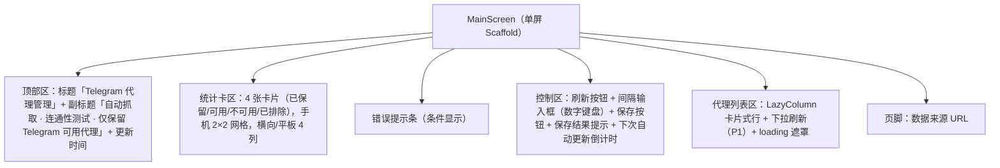
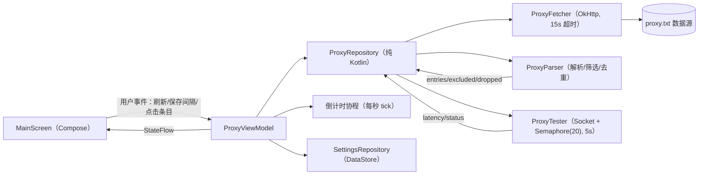

# tgproxy 安卓版 增量 PRD

> 版本：v1.0（增量） | 角色：产品经理 许清楚 | 日期：2026-10-21
> 上游基线：桌面版 tgproxy（已交付，`2026-10-21-23-09-27/tgproxy/`，245 项测试通过）

---

## 1. 项目信息

| 项 | 内容 |
|---|---|
| Language | 简体中文 |
| Programming Language | Kotlin + Jetpack Compose + Material3（单 Activity 架构；网络层 OkHttp；持久化 DataStore Preferences） |
| Project Name | tgproxy_android |
| 原始需求复述 | 在已交付的桌面版 tgproxy 基础上开发**完整的安卓版本应用**：保留原有核心功能与业务流程；明确安卓平台下的界面布局、交互逻辑及必要配置；提供结构清晰、可直接运行或集成的安卓项目代码（达到"用 Android Studio 打开即可构建运行"的完整度）；并说明与现有版本的对应关系。 |

---

## 2. 产品定义

### 2.1 产品目标

| # | 目标 | 衡量标准 |
|---|---|---|
| G1 | **能力完整迁移**：桌面版全部核心功能（抓取/解析/筛选/测试/统计/列表/复制/手动刷新/间隔配置/倒计时/错误提示）在安卓端原生实现，行为与桌面版一致 | 同一数据源文本，安卓端解析结果（保留条目、已排除数、丢弃数）与桌面版完全一致 |
| G2 | **移动场景优化**：针对通勤/单手场景重塑信息架构与交互 | 核心任务（查看可用代理→复制/分享/跳转 Telegram）≤ 3 步完成 |
| G3 | **工程质量达标**：项目达到"Android Studio 打开即可构建运行"完整度 | 无需额外手工配置（Gradle 同步→Run 即可），无桌面版 HTTP 服务器残留依赖 |

### 2.2 产品范围

**本期范围（In Scope）**：桌面版 4 大核心流程的安卓原生实现 + 移动端基础体验增强（P0/P1）。

**不做的事（Out of Scope，本期）**：

- 后台保活 / 系统级定时刷新（WorkManager 列为 P2，本期仅前台定时）
- 账号体系、多数据源管理、代理健康度历史图表
- 数据源 URL 编辑（桌面版 UI 亦未暴露，仅页脚展示，列为 P2）
- 系统级 VPN / 本地代理服务（本应用只做"代理发现与测试"，不提供系统代理能力）
- 平板深度适配（竖屏手机为主，平板自适应 P2）

---

## 3. 用户故事（安卓场景）

| # | 用户故事 |
|---|---|
| US1 | 作为通勤用户，我想打开 App 即可看到当前可用代理列表（可用在前、按延迟升序），以便快速挑出延迟最低的代理 |
| US2 | 作为 Telegram 用户，我想一键复制代理完整链接（`socks5://host:port` 或 MTProto 链接），以便粘贴到 Telegram 的代理设置中 |
| US3 | 作为 Telegram 用户，我想点击 MTProto 代理直接跳转 Telegram 添加代理（P1），以便省去手动复制粘贴 |
| US4 | 作为社群用户，我想把代理链接分享给好友（P1），以便互助获取可用节点 |
| US5 | 作为流量敏感用户，我想按需调整自动刷新频率（通勤时 5 分钟、夜间设 1440 分钟），以便在时效与电量流量间取舍 |
| US6 | 作为弱网用户，我想在抓取失败时看到错误提示且**旧列表仍然保留**，以便不错过上一轮可用数据 |
| US7 | 作为手机用户，我想通过下拉刷新手动触发一轮更新（P1），以便符合移动端直觉 |

---

## 4. 需求池

### 4.1 P0（Must have —— 桌面版核心功能原生实现）

| ID | 需求 | 验收标准 |
|---|---|---|
| P0-1 | 数据源抓取：HTTP GET `https://raw.githubusercontent.com/watchttvv/free-proxy-list/refs/heads/main/proxy.txt`，超时 15s | 抓取失败时记录错误、**保留旧列表**，UI 显示错误条 |
| P0-2 | 解析与筛选：按行解析 `scheme://host:port + 元数据`；严格校验 IPv4（4 段纯数字 0-255，含 X 掩码丢弃）；host:port 去重；仅保留 socks5 与 MTProto（tg://proxy、t.me/proxy、www.t.me/proxy）；http/https/ss/vmess/vless/trojan 等计入「已排除」；提取元数据（入库时间、[标签]剔除、地区、ISP） | 与桌面版 `parse_proxy_text` 输出等价：entries / excluded / dropped 三项计数一致 |
| P0-3 | 连通性测试：对每个保留代理 host:port 做 TCP connect，5s 超时，20 并发；成功记延迟 ms，失败标不可用 | 单轮测试在 20 并发约束下执行；不可用项 latency 为空 |
| P0-4 | 统计：4 项卡片（已保留 / 可用 / 不可用 / 已排除），其中「已排除」= 非 Telegram 类型合法条目 + 非法行（与桌面版 `excluded_count + dropped_count` 一致） | 数字与列表数据实时一致 |
| P0-5 | 代理列表：可用在前、延迟升序；状态徽章（可用/不可用）、类型徽章（SOCKS5/MTProto）、host:port 展示 + 一键复制完整链接、延迟着色（<200ms 绿 / <600ms 橙 / ≥600ms 或失败 红/灰）、地区/ISP/入库时间 | 排序与着色规则与桌面版一致；复制成功有明确反馈 |
| P0-6 | 手动刷新：按钮触发一轮「抓取→测试」，刷新中禁用按钮并显示 loading | 重复点击不并发触发（与桌面版 `_fetching` 互斥语义一致） |
| P0-7 | 自动更新间隔配置：输入 1~1440 分钟（默认 10），保存即生效并**重置倒计时**，持久化 | 非法输入（非整数/越界）阻止保存并提示；重启 App 后配置仍在 |
| P0-8 | 下次更新倒计时：按秒刷新显示（`X 分 X 秒` / `X 秒`） | 前台期间每秒 tick；保存新间隔后立即重置 |
| P0-9 | 错误提示条：抓取失败等错误以红色提示条展示，可被下一轮成功刷新清除 | 与桌面版 error banner 等价 |
| P0-10 | 启动即刷新：App 启动立即执行一轮抓取+测试（与桌面版 main 行为一致）；回前台时同步最新状态 | 冷启动后列表区有 loading → 数据 |
| P0-11 | 数据来源展示：页脚展示当前数据源 URL | 与桌面版 footer 一致 |
| P0-12 | 前台自动刷新：应用处于前台期间，到达间隔自动触发刷新（桌面版前台行为的等价物） | 到达间隔自动刷新且倒计时归零重计 |

### 4.2 P1（Should have —— 平台增强项）

| ID | 需求 | 说明 |
|---|---|---|
| P1-1 | MTProto 链接点击跳转 Telegram：点击列表中的 MTProto 条目发起 `Intent.ACTION_VIEW`（tg://proxy?... 或 https://t.me/proxy?...） | 未安装 Telegram 时 Snackbar 提示「未安装 Telegram」，并降级为复制 |
| P1-2 | 下拉刷新：列表区 SwipeRefresh / Material3 PullToRefresh | 刷新中显示指示器，与按钮刷新互斥 |
| P1-3 | 分享代理链接：长按或条目菜单 `ACTION_SEND` 分享完整链接文本 | 系统分享面板 |
| P1-4 | 深浅色主题：跟随系统 + 手动切换 | 浅色主题与桌面版一致（primary #2563EB）；深色为移动端增强 |
| P1-5 | 复制反馈增强：Snackbar + 条目图标态 1.5s（桌面版按钮文案 1.5s 反馈的等价物） | — |

### 4.3 P2（Nice to have）

| ID | 需求 | 说明 |
|---|---|---|
| P2-1 | 后台定时刷新：WorkManager 周期性任务（15 分钟最小周期约束下按最接近间隔执行） | 需评估电量与厂商后台限制 |
| P2-2 | 桌面小组件（AppWidget）：展示可用数 + 手动刷新 | — |
| P2-3 | 通知栏常驻：显示可用代理数与更新时间 | 需 POST_NOTIFICATIONS 权限（Android 13+） |
| P2-4 | 数据源 URL 编辑（设置页） | 桌面版仅 API 支持，UI 未暴露 |
| P2-5 | 平板自适应（WindowSizeClass：统计 4 列 / 列表双列） | 竖屏手机为主的前提下增强 |

---

## 5. 安卓平台适配规格（架构师直接消费）

### 5.1 界面布局与信息架构

单屏（Single Screen）+ Scaffold 结构，Material3 设计语言，**浅色主题与桌面版一致**，竖屏为主：



**列表行（卡片）内部结构**（对应桌面版 7 列表格的手机化重构）：

```
┌──────────────────────────────────────────┐
│ [状态徽章] [类型徽章]      socks5://1.2.3.4:1080 ⧉ │  ← 第一行：徽章 + 可点击复制的链接（等宽字体）
│ 123 ms（着色）                             │  ← 第二行：延迟（<200 绿 / <600 橙 / ≥600 红 / 失败 灰）
│ 荷兰 北荷兰省 阿姆斯特丹 · DigitalOcean     │  ← 第三行：地区 · ISP
│ 入库时间：10-21 22:58                      │  ← 第四行：入库时间（次要色）
└──────────────────────────────────────────┘
```

- 行点击 = 复制完整链接（与桌面版一致）；MTProto 行点击 = 跳转 Telegram（P1-1），复制/分享经长按菜单（P1-2/P1-3）
- 卡片间 8dp 间距；内容水平 padding 16dp；不可用行整体降透明度 0.6（桌面版灰徽章的等价表达）

**主题色板（与桌面版 1:1 对齐）**：

| 语义 | 色值 | 桌面版出处 |
|---|---|---|
| Primary | #2563EB | 按钮/链接/统计卡左边条 |
| 可用/成功 | #16A34A | 绿徽章、绿延迟、保存成功 |
| 警告/中延迟 | #D97706 | 橙延迟、已排除卡 |
| 错误 | #DC2626 | 红延迟、错误条 |
| 背景 | #F4F6FA | body 背景 |
| 表面 | #FFFFFF | 卡片/表格底色 |
| 边框 | #E5E7EB | 卡片描边 |
| 主文本 | #1F2937 | — |
| 次要文本 | #6B7280 | 副标题/表头 |

Material3 `lightColorScheme(primary = #2563EB, …)` 落地；深色主题 P1-4。

### 5.2 交互逻辑

| 场景 | 规格 |
|---|---|
| 刷新 loading 态 | 按钮变「刷新中…」+ 按钮内 `CircularProgressIndicator`；列表区遮罩「正在抓取并测试代理…」（与桌面版 overlay 一致）；刷新中按钮禁用 |
| 重复刷新 | 与桌面版 `_fetching` 互斥：刷新中再次触发直接忽略（P1 下拉刷新同理） |
| 间隔输入校验 | 仅接受 1~1440 整数；非整数/越界时输入框 error 提示「请输入 1~1440 之间的整数」且**不保存**；保存成功 Snackbar「已保存，立即生效」并重置倒计时 |
| 复制反馈 | `LocalClipboardManager` 写入完整链接 + Snackbar「已复制」；图标态 1.5s（与桌面版 1500ms 一致） |
| MTProto 跳转 | `ACTION_VIEW` + link（tg:// 优先，https://t.me/proxy 兜底）；`ActivityNotFoundException` → Snackbar「未安装 Telegram」并自动复制链接 |
| 空态 | 无数据时列表区显示「暂无数据，请点击「刷新」或等待自动更新」（与桌面版一致） |
| 回前台 | `ON_RESUME` 同步一次状态；若距上次成功刷新已超过设定间隔，立即补一轮刷新（桌面版 visibilitychange poll 的等价物） |
| 退后台 | 暂停倒计时 tick（省电）；间隔到点未刷新则下次回前台补刷（见上） |
| 列表滚动性能 | `LazyColumn` + `key = link` + `contentType`；行布局轻量、无嵌套滚动；图标使用 `Icons.Outlined` 矢量；>200 行仍保持 60fps（验收：中端机滚动无丢帧） |
| 底部提示 | 页脚 `Text` 展示「数据来源：<url>」 |

### 5.3 必要配置

| 项 | 规格 |
|---|---|
| 权限 | 仅 `android.permission.INTERNET`（无存储/位置/通知权限；P2-3 通知栏才引入通知权限） |
| minSdk / targetSdk | minSdk **24**（Android 7.0，覆盖主流存量设备）；targetSdk **35**（compileSdk 35） |
| 架构 | 单 Activity（`MainActivity` + `setContent`）+ Jetpack Navigation Compose（本期单目的地，预留扩展） |
| UI 框架 | Jetpack Compose（BOM 管理版本）+ Material3，**禁止** XML 布局/View 体系混用 |
| 状态管理 | `ProxyViewModel : ViewModel()`，对外暴露 `StateFlow<ProxyUiState>`；UI 层 `collectAsStateWithLifecycle()` |
| 业务层 | `ProxyRepository`（编排：Fetcher→Parser→Tester→排序→统计，**纯 Kotlin 无 Android 依赖**，便于 JVM 单测对拍桌面版） |
| 网络 | OkHttp 4.x（`Dispatchers.IO`），User-Agent 与桌面版一致 `tgproxy/1.0 (local Telegram proxy manager)`；抓取超时 15s |
| 测试 | `ProxyTester`：`java.net.Socket` + `Semaphore(20)` + `Dispatchers.IO` 协程并发；单连接超时 5s |
| 持久化 | DataStore Preferences：键 `interval_minutes`（Int，默认 10，校正 1~1440）、`proxy_list_url`（String，默认官方源，须以 http(s):// 开头）；损坏/越界回退默认值（与桌面版 `normalize_config` 一致） |
| 倒计时 | ViewModel 内协程每秒 tick，暴露 `countdownSec: Int`；保存新间隔立即重置（与桌面版 `set_interval_minutes` 一致） |
| 横竖屏 | 竖屏优化为主；不锁死旋转，横屏时布局自适应伸缩（统计网格列数自适应）；平板 WindowSizeClass 为 P2 |
| 构建 | Gradle Version Catalog 管理依赖；`gradlew` 入库；无本地 SDK 路径硬编码（`local.properties` 不提交） |

### 5.4 数据模型（建议，架构师可微调字段名）

```
ProxyUiState {
  updatedAt: String?      // "yyyy-MM-dd HH:mm:ss"，桌面版 updated_at
  fetching: Boolean       // 刷新中
  error: String?          // 错误信息（抓取失败等）
  stats: Stats            // totalKept / available / unavailable / excluded
  proxies: List<ProxyEntry>  // 已排序（可用在前、延迟升序）
  countdownSec: Int       // 距下次自动刷新秒数
}

ProxyEntry {
  link: String            // "socks5://host:port" 或 MTProto 完整链接
  host: String            // 严格校验后的 IPv4
  port: Int
  type: SOCKS5 | MTPROTO
  latencyMs: Int?         // 失败为 null
  status: AVAILABLE | UNAVAILABLE
  location: String        // 地区
  isp: String
  addedAt: String         // 入库时间（如 "10-21 22:58"）
}

Settings { intervalMinutes: Int = 10; proxyListUrl: String = DEFAULT_PROXY_LIST_URL }
```

### 5.5 数据流（响应式，无本地服务器）



---

## 6. 与桌面版的对应关系表

### 6.1 proxy_manager.py 拆分映射

| 桌面版函数/类 | 职责 | 安卓版组件 | 移植要点 |
|---|---|---|---|
| `parse_ipv4` / `parse_port` | IPv4（4 段纯数字 0-255）与端口（1~65535）严格校验 | `ProxyParser` 内联校验函数 | 规则逐字一致；含 X 掩码一律丢弃 |
| `_parse_meta` | 入库时间 / 地区 / ISP 提取（剔除 [标签]、按「—」拆分） | `ProxyParser` | 正则等价移植，保留 `—` 多形态兼容 |
| `_is_mtproto_url` / `_parse_mtproto` | 识别 `tg://proxy?…` 与 `t.me/proxy?…`；提取 server/port/secret | `ProxyParser` | 两种形态都要识别；secret 缺失则丢弃该行 |
| `parse_proxy_text` | 解析 + 仅留 socks5/MTProto + host:port 去重 + excluded/dropped 计数 | `ProxyParser.parse()` | 返回三元组与桌面版一致；**excluded 计数含 dropped**（在统计层合并） |
| `fetch_proxy_text` | HTTP 抓取，15s 超时 | `ProxyFetcher`（OkHttp + `Dispatchers.IO`） | UA 字符串保持一致；失败抛错由上层保留旧列表 |
| `test_tcp_latency` | TCP connect，5s 超时 | `ProxyTester`（Socket + `Semaphore(20)`） | 并发上限 20；失败记 null |
| `sort_proxies` | 可用在前、延迟升序、host/port 兜底 | `ProxyRepository` 排序函数 | 排序键完全一致 |
| `ProxyManager`（锁 + 状态快照 + refresh 互斥） | 状态管理 | `ProxyRepository`（数据与流程）+ `ProxyViewModel`（UiState + 互斥） | 线程锁 → 协程互斥/单线程化；`get_state()` 快照 → `StateFlow` |

### 6.2 app.py 映射（本地 HTTP 服务的消亡）

| 桌面版组件 | 职责 | 安卓版对应 | 说明 |
|---|---|---|---|
| `load_config` / `save_config` / `normalize_config` | config.json 读写与范围校正 | `SettingsRepository`（DataStore Preferences） | 键与校正规则一致；config.json 文件概念消失 |
| `RefreshScheduler` | 后台线程定时 + 倒计时，间隔热更新重置 | ViewModel 内倒计时协程（前台，P0-12）；WorkManager（P2-1） | 前台行为一致；后台定时本期不做 |
| `TgProxyServer` / `ApiHandler` / `_serve_static` / 端口探测 | 本地 HTTP 服务 + JSON API + 静态页 | **无（消亡）** | 安卓端无本地服务器、无端口、无 REST API；ViewModel 直接持有状态并向 UI 推送 |
| `main()` 启动流程 | 启动即一轮刷新 + 调度线程 | `MainActivity.onCreate` → ViewModel 初始化 → 立即刷新 + 启动倒计时 | 启动即刷新的语义保留 |
| `GET /api/proxies` / `POST /api/refresh` / `POST /api/settings` | API 端点 | ViewModel 方法（`refresh()` / `saveInterval()`） | 由网络请求变为进程内方法调用 |
| `create_server` 端口占用顺延 | 端口冲突处理 | 无 | 端口概念整体消失 |

### 6.3 static/index.html → Compose 界面映射

| 桌面版 UI 元素 | 安卓版 Composable | 说明 |
|---|---|---|
| `#updated-at`（更新时间） | TopAppBar 副标题或顶部行 | — |
| `.stats-grid` 4 张 `.stat-card` | 统计卡区（`Row`/自适应网格，手机 2×2） | 数值与左边条色一致 |
| `#error-banner` | 条件显示的错误条（红色 Surface） | 文案直传 `error` |
| `#refresh-btn` + `.loading-overlay` | `Button`（内含 CircularProgressIndicator）+ 列表 loading 遮罩 | 刷新中互斥禁用 |
| `#interval-input` + `#save-interval-btn` + `#settings-msg` | `OutlinedTextField`（数字键盘）+ `Button` + Snackbar/inline 提示 | 校验 1~1440 |
| `#countdown` | 倒计时 `Text`（ViewModel 每秒 tick 驱动） | 格式 `X 分 X 秒` / `X 秒` |
| `table` 7 列行 | 卡片式列表行（见 5.1） | 表格 → 卡片：手机宽度约束下的等价重构 |
| `.link-btn` 点击复制 + 「已复制」1.5s | 行点击复制 + Snackbar + 图标态 1.5s | ClipboardManager |
| `.badge-*`（状态/类型） | Material3 `AssistChip` / 自定义 Badge | 配色一一对应 |
| `.lat-*`（延迟着色） | `Text` color 按阈值切换 | <200 绿 / <600 橙 / ≥600 红 / null 灰 |
| `#source-url` 页脚 | 页脚 `Text` | — |
| `setInterval(poll, 2500)` + `visibilitychange` | **无轮询**：StateFlow 响应式推送；`ON_RESUME` 同步 | 轮询模型被响应式数据流取代 |
| `fetchJson(...)` 客户端调用 | 进程内 ViewModel 调用 | 网络层仅保留「数据源抓取」一跳 |

---

## 7. 验收与对拍建议（供测试角色消费）

1. **解析对拍**：构造与桌面版同源的样例文本（含 socks5/MTProto/http/掩码 X/重复 host:port/缺 secret 的 MTProto/无元数据行），安卓端 `ProxyParser.parse()` 的 entries/excluded/dropped 须与桌面版 `parse_proxy_text` 完全一致。
2. **排序对拍**：混合 available/unavailable 与多档延迟，验证排序键一致。
3. **刷新互斥**：刷新中连续触发刷新/下拉刷新，不得并发第二轮。
4. **失败保留**：mock 抓取失败，验证旧列表保留 + 错误条展示 + 下一轮成功清除错误。
5. **间隔边界**：0 / 1 / 1440 / 1441 / 非数字 / 空输入的保存行为与持久化结果。
6. **倒计时重置**：修改间隔后倒计时立即按新值重新计时。
7. **复制与跳转**：复制后剪贴板内容 = 完整链接；MTProto 点击在有/无 Telegram 时的两种表现。

---

## 8. 待确认问题

1. **无阻塞性问题。** 以下为带建议的非阻塞决策点，架构师可按建议执行：
   - 数据源 URL 编辑是否本期做？—— 建议 P2（与桌面版 UI 保持一致，仅页脚展示）。
   - 深色主题是否随本期发布？—— 建议 P1-4 一并交付（成本低，移动端用户预期强）。
   - 平板双列适配是否本期做？—— 建议 P2，本期保证横屏可用即可。
   - WorkManager 最小周期 15 分钟与用户设置 <15 分钟间隔存在平台限制差异 —— P2 阶段再评估，本期文档已注明。

---

*本 PRD 不包含代码实现细节；技术选型（OkHttp/DataStore/Compose BOM 具体版本）由架构师在技术方案中确定。*
